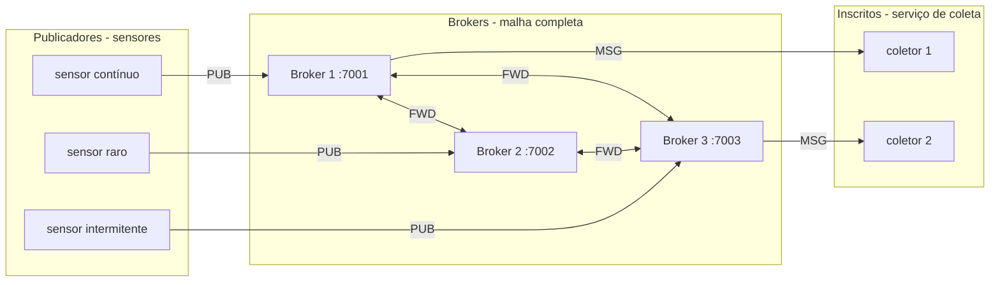
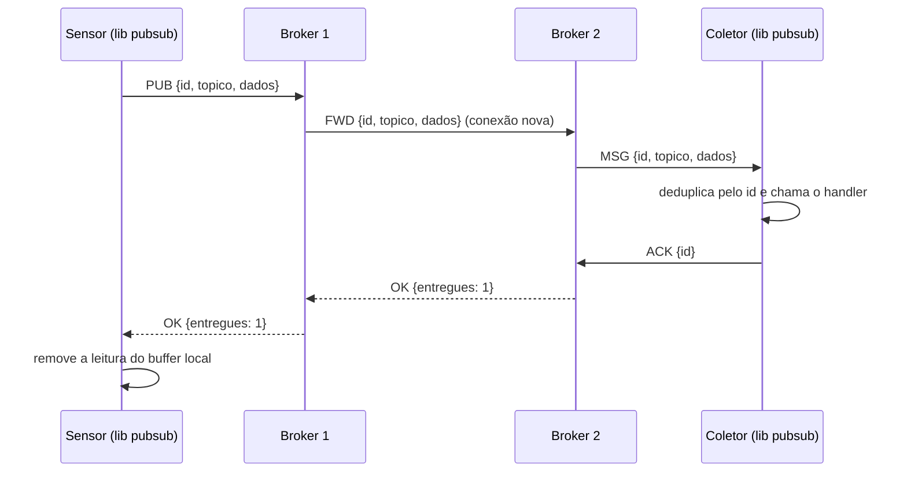
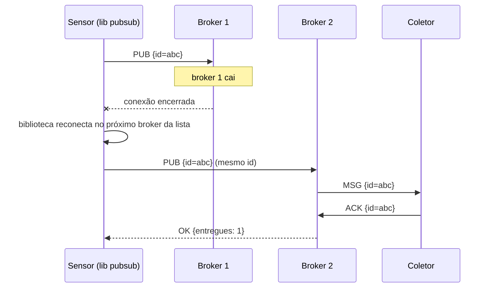
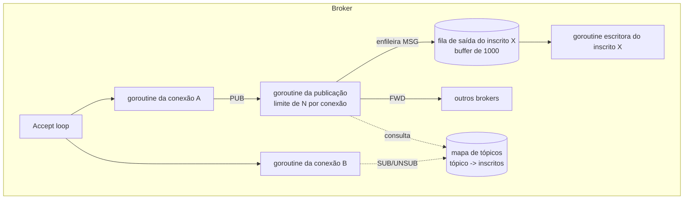

# Middleware Publish/Subscribe — Telemetria de Sensores Remotos

Projeto da disciplina **Programação Distribuída** (IFPB — Campus João Pessoa, Prof. Ruan Delgado Gomes).

Middleware Pub/Sub escrito em **Go**, sem nenhuma dependência externa (só a biblioteca padrão), composto por:

- um **broker** (componente intermediário) que pode rodar em várias instâncias;
- uma **biblioteca cliente** (`pubsub`) usada pelas aplicações para publicar, se inscrever e remover inscrição;
- **aplicações de exemplo** (sensor, coletor e um gerador de carga que extrai métricas).

O cenário escolhido foi o **Cenário A — Telemetria de Sensores Remotos**: baixo volume, latência relaxada e **alta confiabilidade por mensagem**, com sensores que se conectam de forma intermitente.

---

## Sumário

1. [Cenário escolhido e o que ele exige](#1-cenário-escolhido-e-o-que-ele-exige)
2. [Estrutura do repositório](#2-estrutura-do-repositório)
3. [Arquitetura](#3-arquitetura)
4. [Protocolo](#4-protocolo)
5. [Onde e como cada requisito mínimo foi implementado](#5-onde-e-como-cada-requisito-mínimo-foi-implementado)
6. [Como o sistema atende às restrições do Cenário A](#6-como-o-sistema-atende-às-restrições-do-cenário-a)
7. [Decisões de projeto e tradeoffs](#7-decisões-de-projeto-e-tradeoffs)
8. [Documentação da biblioteca cliente](#8-documentação-da-biblioteca-cliente)
9. [Como executar](#9-como-executar)
10. [Testes de carga e métricas](#10-testes-de-carga-e-métricas)
11. [Limitações conhecidas](#11-limitações-conhecidas)

---

## 1. Cenário escolhido e o que ele exige

> Biólogos marinhos instalam sensores de baixo consumo para monitorar a temperatura da água. Os sensores se conectam de forma intermitente (ficam horas offline e depois voltam). Alguns enviam poucas leituras por dia; outros, um fluxo contínuo. O serviço de coleta não pode ficar indisponível quando um sensor falha ou some, e um sensor lento ou em má conexão não pode atrasar a entrega dos dados dos outros.

| Dimensão | Exigência | Consequência no projeto |
|---|---|---|
| Volume | Baixo | Não é preciso otimizar throughput. Dá para usar JSON, uma conexão nova por encaminhamento entre brokers e uma goroutine por publicação. |
| Latência | Relaxada | Failover pode levar alguns segundos e a confirmação pode esperar a entrega aos inscritos. |
| Confiabilidade | Alta, por mensagem | Toda leitura precisa chegar. Usamos confirmação fim a fim (o publicador só descarta a leitura quando sabe que ela chegou aos inscritos), retransmissão e deduplicação. |
| Disponibilidade | Serviço não pode cair | Vários brokers, failover automático na biblioteca, brokers não guardam estado que precise ser recuperado. |
| Justiça | Um sensor ruim não atrapalha os outros | Uma goroutine por conexão, limite de publicações em andamento por conexão, filas de saída separadas por cliente, timeouts. |

A ideia central do projeto é: **como a latência é relaxada e o volume é baixo, a confiabilidade pode ser garantida pela própria confirmação fim a fim**, sem precisar de disco nem replicação de dados entre brokers. A mensagem fica guardada no publicador até ele ter certeza de que ela foi entregue.

---

## 2. Estrutura do repositório

```
middleware-pubsub/
├── protocolo/
│   └── mensagem.go          # formato das mensagens trocadas (struct + tipos)
├── broker/
│   ├── broker.go            # broker: tópicos, inscrições, publicação, encaminhamento entre brokers
│   └── cliente.go           # conexão de um cliente dentro do broker (fila de saída, ACKs pendentes)
├── cmd/
│   └── broker/main.go       # executável do broker (flags de linha de comando)
├── pubsub/
│   └── cliente.go           # BIBLIOTECA CLIENTE usada pelas aplicações
├── exemplos/
│   ├── leitura/leitura.go   # formato da leitura de temperatura usada nos exemplos
│   ├── sensor/main.go       # sensor: publica leituras, guarda no buffer local enquanto offline
│   ├── coletor/main.go      # serviço de coleta: se inscreve/desinscreve em tópicos em tempo de execução
│   └── carga/main.go        # gerador de carga: dezenas de sensores heterogêneos + coletores + métricas
├── scripts/
│   ├── iniciar_brokers.sh   # compila tudo e sobe 3 brokers (7001, 7002, 7003)
│   ├── parar_brokers.sh
│   ├── teste_normal.sh      # teste de carga de 60s
│   └── teste_falha.sh       # teste de carga de 60s derrubando um broker no meio
└── go.mod
```

---

## 3. Arquitetura

### 3.1 Visão geral



- Cada aplicação usa a biblioteca `pubsub` e recebe a **lista de todos os brokers**. A biblioteca escolhe um deles (começando por um índice aleatório, para espalhar os clientes) e mantém **uma única conexão TCP** com ele.
- Os brokers formam uma **malha completa**: cada broker conhece os outros pela flag `-pares`.
- Quando um broker recebe uma publicação de um cliente, ele entrega aos seus inscritos locais **e** encaminha a mensagem (`FWD`) para os outros brokers, que entregam aos inscritos deles. Assim, o publicador e o inscrito podem estar em brokers diferentes sem saber disso.
- Um broker que recebe `FWD` só entrega localmente, nunca reencaminha, o que evita loops.

### 3.2 Fluxo de uma publicação (caminho feliz)



O `OK` só volta para o publicador **depois** que todos os inscritos (em todos os brokers) confirmaram com `ACK`. Por isso chamamos de **confirmação fim a fim**.

### 3.3 Fluxo com falha de broker



Se o coletor já tinha recebido `abc` antes da queda, ele recebe de novo, mas a biblioteca descarta a duplicata pelo `id` (mesmo assim manda o `ACK`). O resultado é entrega **pelo menos uma vez** no protocolo e **exatamente uma vez** para a aplicação (dentro da janela de deduplicação).

### 3.4 Dentro do broker



- **Uma goroutine de leitura por conexão** (`Broker.atender`): lê as mensagens JSON do cliente.
- **Uma goroutine por publicação** (limitadas a `-max-pendentes` por conexão): entrega aos inscritos, encaminha para os pares e espera os `ACK`s.
- **Uma fila de saída por cliente** (`cliente.saida`, canal com buffer de `-buffer` posições) e **uma goroutine escritora** por cliente (`cliente.escrever`). É essa fila que absorve rajadas.
- **Mapa de tópicos** (`Broker.topicos`): `map[string]map[*cliente]bool`, protegido por mutex.

---

## 4. Protocolo

Transporte: **TCP**. Formato: **JSON, uma mensagem por linha** (o `json.Encoder` do Go coloca `\n` no fim de cada objeto). Todas as mensagens usam a mesma struct, definida em [`protocolo/mensagem.go`](protocolo/mensagem.go):

```go
type Mensagem struct {
    Tipo      string `json:"tipo"`
    ID        string `json:"id,omitempty"`
    Topico    string `json:"topico,omitempty"`
    Dados     string `json:"dados,omitempty"`
    Entregues int    `json:"entregues,omitempty"`
    Erro      string `json:"erro,omitempty"`
}
```

| Tipo | Direção | Significado |
|---|---|---|
| `PUB` | cliente → broker | Publica `dados` no `topico`. O `id` é gerado pela biblioteca e é o mesmo em todas as retransmissões. |
| `SUB` | cliente → broker | Inscreve a conexão no `topico`. |
| `UNSUB` | cliente → broker | Remove a inscrição no `topico`. |
| `ACK` | cliente → broker | Confirma que a mensagem `id` foi recebida e processada pela aplicação. |
| `FWD` | broker → broker | Publicação encaminhada por outro broker. Só é entregue localmente. |
| `MSG` | broker → cliente | Entrega de uma mensagem a um inscrito. |
| `OK` | broker → cliente/broker | Sucesso. Em resposta a `PUB`/`FWD`, `entregues` diz para quantos inscritos foi entregue. |
| `SEM_INSCRITOS` | broker → cliente/broker | A mensagem foi descartada porque o tópico não tem inscritos em nenhum broker. |
| `ERRO` | broker → cliente/broker | Algum inscrito não confirmou a tempo (ou tipo inválido). A biblioteca retransmite. |

Exemplo de uma troca real:

```json
{"tipo":"PUB","id":"0c498fc4d34511ad","topico":"temperatura/costa-norte","dados":"{\"sensor\":\"s1\",\"seq\":7,\"temperatura\":26.4,\"gerada\":1761488073000000000}"}
{"tipo":"MSG","id":"0c498fc4d34511ad","topico":"temperatura/costa-norte","dados":"{...}"}
{"tipo":"ACK","id":"0c498fc4d34511ad"}
{"tipo":"OK","id":"0c498fc4d34511ad","topico":"temperatura/costa-norte","entregues":1}
```

Como é texto puro, dá para testar o broker na mão com `nc localhost 7001` e digitar as mensagens.

---

## 5. Onde e como cada requisito mínimo foi implementado

Resumo rápido:

| # | Requisito | Onde | Como |
|---|---|---|---|
| R1 | Mensagens com tópico | `protocolo/mensagem.go` | Campo `Topico` em toda mensagem |
| R2 | Publicar, se inscrever e remover inscrição | `pubsub/cliente.go` (`Publicar`, `Inscrever`, `Desinscrever`) e `broker/broker.go` (`atender`) | Comandos `PUB`, `SUB`, `UNSUB` |
| R3 | Tópicos com ciclo de vida dinâmico | `broker/broker.go` (`inscrever`, `removerInscricao`, `removerCliente`) | Tópico nasce na 1ª inscrição e morre quando sai o último inscrito |
| R4 | Tópico sem inscritos: descarta e avisa o publicador | `broker/broker.go` (`publicar`) e `pubsub/cliente.go` (`ErrSemInscritos`) | Resposta `SEM_INSCRITOS`, que vira o erro `ErrSemInscritos` |
| R5 | Tópico com inscritos: entrega a todos e depois apaga | `broker/broker.go` (`publicar`, `encaminhar`) e `broker/cliente.go` (`entregar`) | Entrega local + encaminhamento, espera todos os `ACK`s, a mensagem não fica guardada |
| R6 | Rajadas bufferizadas | `broker/cliente.go` (`saida`, `escrever`) e `pubsub/cliente.go` (`entregas`) | Filas (canais com buffer) por cliente no broker e na biblioteca |
| R7 | Múltiplos brokers transparentes | `pubsub/cliente.go` (`conectar`, `reconectar`, `requisitar`) e `broker/broker.go` (`encaminhar`) | Lista de brokers, failover automático, reinscrição automática, encaminhamento entre brokers |

### R1 — Mensagens com tópico

Toda mensagem do protocolo tem o campo `Topico` ([`protocolo/mensagem.go`](protocolo/mensagem.go)). Na biblioteca, `Publicar(topico, dados)` recebe o tópico e o handler de `Inscrever` recebe uma `pubsub.Mensagem` com `ID`, `Topico` e `Dados`. Os tópicos são strings livres; nos exemplos usamos `temperatura/<regiao>`.

### R2 — Publicar, se inscrever e remover inscrição

- **Biblioteca** ([`pubsub/cliente.go`](pubsub/cliente.go)):
  - `Publicar(topico string, dados []byte) (int, error)` envia `PUB` e espera a resposta. Retorna quantos inscritos receberam.
  - `Inscrever(topico string, h Handler) error` guarda o handler no mapa `inscricoes` e envia `SUB`.
  - `Desinscrever(topico string) error` tira o handler do mapa e envia `UNSUB`.
- **Broker** ([`broker/broker.go`](broker/broker.go)), no `switch` da função `atender`:
  - `PUB` → `publicar`
  - `SUB` → `inscrever` e responde `OK`
  - `UNSUB` → `desinscrever` e responde `OK`
- **Demonstração:** o coletor aceita os comandos `inscrever <topico>` e `desinscrever <topico>` no terminal enquanto está rodando (ver [seção 9.4](#94-demonstrando-cada-requisito)).

### R3 — Tópicos com ciclo de vida dinâmico

Decidimos que o ciclo de vida do tópico é **implícito**, ligado às inscrições:

- **Criação:** em `Broker.inscrever`, se o tópico não existe no mapa `topicos`, ele é criado (log `topico criado: ...`).
- **Remoção:** em `Broker.removerInscricao`, quando o último inscrito sai, o tópico é apagado do mapa (log `topico removido: ...`). Isso acontece tanto num `UNSUB` quanto quando a conexão do inscrito cai (`Broker.removerCliente`).
- Publicar num tópico que não existe é o mesmo que publicar num tópico sem inscritos (R4).

**Por que implícito e não com comandos `CRIAR`/`APAGAR`?** Com vários brokers, um tópico criado explicitamente teria que ser replicado em todos e sobreviver à queda de um broker. Do jeito implícito, cada broker só sabe dos tópicos dos seus próprios clientes, e quando um cliente troca de broker a biblioteca refaz as inscrições e o tópico é recriado sozinho. Não existe estado global para sincronizar. É o mesmo modelo do pub/sub do Redis e dos tópicos do MQTT.

### R4 — Mensagem em tópico sem inscritos é descartada, com ciência do publicador

Em `Broker.publicar`: a mensagem é entregue aos inscritos locais e encaminhada para os pares. Cada par responde quantos inscritos tinha. Se a soma for **zero** (e não houve falha), o broker:

1. não guarda a mensagem em lugar nenhum (descarte);
2. registra no log `mensagem <id> descartada: topico <t> sem inscritos`;
3. responde `SEM_INSCRITOS` ao publicador.

Na biblioteca, `Publicar` transforma essa resposta no erro **`pubsub.ErrSemInscritos`**. Ou seja, o publicador fica sabendo de forma explícita.

**E a confiabilidade?** O broker cumpre o requisito à risca e descarta. Quem decide o que fazer com a leitura é a aplicação. No nosso sensor ([`exemplos/sensor/main.go`](exemplos/sensor/main.go), função `enviarBuffer`), ao receber `ErrSemInscritos` a leitura **continua no buffer local** e é reenviada no próximo ciclo. Assim, se o serviço de coleta estiver fora do ar por um tempo, nenhuma leitura se perde, e o broker continua sem guardar nada.

### R5 — Mensagem em tópico com inscritos é encaminhada a todos e depois apagada

Em `Broker.publicar`:

1. Pega uma cópia da lista de inscritos locais do tópico (`Broker.inscritos`).
2. Para **cada inscrito**, em paralelo, chama `cliente.entregar`, que coloca uma `MSG` na fila de saída do inscrito e espera o `ACK` (com timeout `-timeout-entrega`).
3. Para **cada broker par**, em paralelo, chama `Broker.encaminhar`, que abre uma conexão, envia `FWD` e espera a resposta com a quantidade de entregas daquele broker.
4. Espera todos terminarem (`sync.WaitGroup`).
5. Responde `OK` com o total de `entregues`. Se algum inscrito não confirmou, responde `ERRO` e o publicador retransmite.

Depois disso a mensagem **não existe mais em nenhum lugar do broker**. Ela só viveu na pilha da goroutine e na fila de saída enquanto estava sendo entregue. Não existe armazenamento de mensagens no broker.

### R6 — Rajadas de mensagens em um tópico são bufferizadas

Os buffers são:

| Buffer | Onde | Tamanho | Para que serve |
|---|---|---|---|
| Fila de saída por cliente | `broker/cliente.go`, campo `saida` | flag `-buffer` (padrão 1000) | Quando chega uma rajada num tópico, as `MSG`s se acumulam na fila de cada inscrito e a goroutine `escrever` vai mandando no ritmo que a conexão aguenta. |
| Publicações em andamento por conexão | `broker/broker.go`, canal `limite` em `atender` | flag `-max-pendentes` (padrão 50) | Até 50 publicações de uma mesma conexão são processadas ao mesmo tempo. Acima disso o broker para de ler daquela conexão e o próprio TCP segura o resto (no buffer do socket). |
| Fila de entregas na biblioteca | `pubsub/cliente.go`, campo `entregas` | 1000 | Do lado do inscrito, as mensagens recebidas esperam aqui enquanto o handler processa as anteriores. |
| Buffer local do sensor | `exemplos/sensor/main.go`, variável `buffer` | ilimitado | Leituras geradas enquanto o sensor está offline ou sem inscritos. Quando ele volta, envia tudo, gerando uma rajada. |

O teste de carga tem sensores do perfil `rajada`, que disparam **100 publicações simultâneas** a cada 15 s, e os sensores intermitentes também geram rajadas ao voltar. Nenhuma mensagem é perdida nesses casos (ver [seção 10](#10-testes-de-carga-e-métricas)).

### R7 — Múltiplos brokers de forma transparente para a biblioteca

**No cliente** ([`pubsub/cliente.go`](pubsub/cliente.go)), a aplicação só faz:

```go
c, err := pubsub.Conectar([]string{"localhost:7001", "localhost:7002", "localhost:7003"})
```

E a biblioteca cuida de tudo:

- `conectar`: tenta os brokers da lista em ordem circular, começando de um índice aleatório (espalha os clientes entre os brokers).
- `ler`: quando a conexão cai, avisa as requisições pendentes (para elas retransmitirem na hora, sem esperar timeout) e chama `reconectar`.
- `reconectar`: tenta o próximo broker da lista, e fica tentando a cada 1 s até conseguir.
- Ao reconectar, `conectar` **refaz automaticamente todas as inscrições** que estão no mapa `inscricoes`.
- `requisitar`: se a resposta não chegar (queda ou timeout), retransmite a mesma mensagem, **com o mesmo `id`**, até `Tentativas` vezes, já no broker novo.

**No broker** ([`broker/broker.go`](broker/broker.go)), a função `encaminhar` leva a publicação aos outros brokers. Assim não importa em qual broker o publicador e o inscrito estão conectados. Se um par está fora do ar (não aceita conexão), ele é ignorado, porque os clientes dele já migraram para os brokers vivos.

A aplicação nunca sabe em qual broker está (a não ser que pergunte com `BrokerAtual()`, que existe só para log).

---

## 6. Como o sistema atende às restrições do Cenário A

### 6.1 Alta confiabilidade por mensagem

Combinação de quatro mecanismos:

1. **Confirmação fim a fim:** o publicador só recebe `OK` depois que **todos** os inscritos mandaram `ACK`. E o inscrito só manda `ACK` **depois** que o handler da aplicação terminou (`processarEntregas` na biblioteca).
2. **Mensagem guardada no publicador:** enquanto não recebe `OK`, a leitura fica no buffer do sensor. Se o broker cair no meio do caminho, nada se perde, porque a cópia que importa está no publicador.
3. **Retransmissão com o mesmo `id`:** a biblioteca retransmite em caso de queda de conexão, timeout ou `ERRO`.
4. **Deduplicação no inscrito:** a biblioteca guarda os últimos 10.000 `id`s recebidos (`jaRecebida`) e não entrega duplicatas para a aplicação.

Garantia final: **toda leitura gerada chega ao serviço de coleta, sem duplicatas para a aplicação**, mesmo com queda de broker. Nos testes, a perda foi 0 (inclusive derrubando um broker com `kill -9`).

### 6.2 Sensores intermitentes (horas offline)

Tratado na aplicação do sensor (e no perfil `intermitente` do teste de carga): enquanto está offline, o sensor fecha a conexão, continua gerando leituras e guarda tudo no buffer local. Quando volta, conecta (em qualquer broker) e envia o buffer em ordem. A latência dessas leituras é alta por natureza (inclui o tempo offline), o que é aceitável porque a latência do cenário é relaxada.

### 6.3 Disponibilidade

- Vários brokers rodando ao mesmo tempo. A queda de um não para o serviço: os clientes dele migram sozinhos para outro.
- O broker **não guarda estado que precise ser recuperado** (nem mensagens nem tópicos persistentes). Um broker que reinicia volta a funcionar na hora, sem processo de recuperação.
- A queda de um **sensor** não afeta nada: o broker apenas fecha a conexão e remove as inscrições dele (se tiver).

### 6.4 Justiça (um sensor lento não atrasa os outros)

- **Uma goroutine por conexão:** um sensor com conexão ruim, que manda bytes devagar ou trava no meio de uma mensagem, só bloqueia a própria goroutine de leitura. O teste de carga abre 5 conexões que **travam no meio de um JSON** e ficam assim o teste inteiro, e os outros sensores não sentem diferença.
- **Limite de publicações em andamento por conexão (`-max-pendentes`):** um sensor que dispara muitas mensagens de uma vez não consegue criar goroutines infinitas no broker. Acima do limite, quem espera é só ele.
- **Fila de saída separada por inscrito:** um inscrito lento enche apenas a própria fila.
- **Timeouts:** escrita com deadline de 10 s, espera de `ACK` com `-timeout-entrega`, encaminhamento com `-timeout-par`. Nenhuma operação fica presa para sempre.
- **TCP keepalive** (padrão do Go) detecta conexões mortas que não fecharam direito.

### 6.5 Baixo volume e latência relaxada

Essas duas restrições foram usadas para **simplificar**:

- JSON em vez de formato binário (fácil de depurar);
- uma conexão TCP nova a cada encaminhamento entre brokers, em vez de um pool de conexões;
- o publicador espera a confirmação de cada leitura antes de mandar a próxima (no sensor);
- failover de até alguns segundos é aceitável.

---

## 7. Decisões de projeto e tradeoffs

| Decisão | O que ganhamos | O que perdemos |
|---|---|---|
| **Confirmação fim a fim** (OK só depois dos ACKs de todos os inscritos) em vez de ACK do broker + persistência | Confiabilidade sem disco e sem replicação entre brokers. Broker sem estado. | Latência maior por mensagem (espera a ida e volta até o inscrito). Um inscrito lento atrasa a confirmação dos publicadores daquele tópico. Aceitável pela latência relaxada. |
| **Mensagem fica no publicador até ser entregue** | Queda do broker não perde nada. | O publicador precisa de memória para o buffer. Para sensores com poucas leituras por dia, isso é pequeno. |
| **Entrega pelo menos uma vez + deduplicação por `id`** | Simples de implementar e de raciocinar. | Duplicatas podem trafegar na rede. A deduplicação tem janela de 10.000 ids por cliente. |
| **Malha completa de brokers com encaminhamento (`FWD`)** | Qualquer cliente pode se conectar em qualquer broker. Não precisa de coordenação nem de eleição de líder. | Cada publicação gera N-1 encaminhamentos. Não escala para dezenas de brokers, mas para baixo volume e 3 brokers é suficiente. Configuração dos pares é estática. |
| **Conexão nova por encaminhamento** | Código muito mais simples (sem multiplexação nem pool). | Custo de handshake TCP por mensagem. Irrelevante para baixo volume. |
| **Ciclo de vida implícito dos tópicos** | Sem estado global de tópicos. Failover reconstrói tudo sozinho. | Não dá para "criar um tópico vazio" e ele existir sem inscritos. Como publicar num tópico sem inscritos já é descarte, isso não faz falta no cenário. |
| **Inscrições não duráveis** | O broker não guarda mensagens para quem não está inscrito, cumprindo R4 e R5 literalmente. | Um inscrito que está fora do ar não recebe o que foi publicado nesse intervalo. Por isso a confiabilidade é garantida pelo publicador, que recebe `SEM_INSCRITOS` e tenta de novo depois. |
| **TCP + JSON por linha** | Confiável e ordenado por conexão, fácil de depurar com `nc`. | Mais bytes que um formato binário. Irrelevante para baixo volume. |
| **Goroutine por conexão e por publicação** | Isolamento natural entre clientes (justiça) com código sequencial e simples. | Uso de memória proporcional ao número de conexões. Goroutines são leves (alguns KB), então não é problema na escala do cenário. |

---

## 8. Documentação da biblioteca cliente

Pacote: `github.com/FelipeBritoLC/middleware-pubsub/pubsub`

### 8.1 Exemplo mínimo

```go
package main

import (
    "fmt"
    "log"

    "github.com/FelipeBritoLC/middleware-pubsub/pubsub"
)

func main() {
    c, err := pubsub.Conectar([]string{"localhost:7001", "localhost:7002", "localhost:7003"})
    if err != nil {
        log.Fatal(err)
    }
    defer c.Fechar()

    c.Inscrever("temperatura/costa-norte", func(m pubsub.Mensagem) {
        fmt.Printf("recebi em %s: %s\n", m.Topico, string(m.Dados))
    })

    n, err := c.Publicar("temperatura/costa-norte", []byte("26.4"))
    if err == pubsub.ErrSemInscritos {
        fmt.Println("ninguem inscrito, mensagem descartada")
    } else if err != nil {
        fmt.Println("erro:", err)
    } else {
        fmt.Println("entregue para", n, "inscrito(s)")
    }

    c.Desinscrever("temperatura/costa-norte")
}
```

### 8.2 API

#### `func Conectar(brokers []string) (*Cliente, error)`

Conecta a um dos brokers da lista (começando por um aleatório). Retorna `ErrDesconectado` se nenhum estiver disponível. Depois de conectado, a reconexão é automática para sempre, até `Fechar()`.

#### `func (c *Cliente) Publicar(topico string, dados []byte) (int, error)`

Publica e **bloqueia até a confirmação fim a fim**. Retornos:

| Retorno | Significado |
|---|---|
| `n, nil` | Entregue e confirmada por `n` inscritos (somando todos os brokers). |
| `0, ErrSemInscritos` | O tópico não tinha inscritos. O broker descartou a mensagem. |
| `0, outro erro` | Não foi possível confirmar depois de `Tentativas` tentativas (todos os brokers fora, por exemplo). A aplicação deve guardar a mensagem e tentar depois. |

Pode ser chamada por várias goroutines ao mesmo tempo (o teste de carga faz isso para gerar rajadas).

#### `func (c *Cliente) Inscrever(topico string, h Handler) error`

Inscreve no tópico. O `Handler` (`func(pubsub.Mensagem)`) é chamado **uma vez por mensagem** (duplicatas são filtradas), sempre na mesma goroutine, na ordem de chegada. O `ACK` só é enviado depois que o handler retorna, então se o processo morrer dentro do handler a mensagem é reenviada. A inscrição é refeita automaticamente após reconexão.

#### `func (c *Cliente) Desinscrever(topico string) error`

Remove a inscrição. Se era o último inscrito daquele tópico no broker, o tópico é apagado.

#### `func (c *Cliente) Fechar()`

Fecha a conexão e para a reconexão automática. As inscrições do cliente são removidas pelo broker.

#### `func (c *Cliente) BrokerAtual() string`

Endereço do broker em uso no momento. Serve só para log e depuração.

#### Tipos e variáveis

```go
type Mensagem struct {
    ID     string
    Topico string
    Dados  []byte
}

type Handler func(Mensagem)

var (
    ErrSemInscritos
    ErrDesconectado
    ErrFechado
    ErrTentativas
)
```

#### Campos configuráveis

| Campo | Padrão | Descrição |
|---|---|---|
| `c.Timeout` | 15 s | Tempo máximo esperando a resposta de uma requisição antes de retransmitir. Precisa ser maior que `-timeout-entrega` + `-timeout-par` do broker. |
| `c.Tentativas` | 5 | Quantas vezes uma requisição é tentada antes de retornar erro. |

---

## 9. Como executar

### 9.1 Pré-requisitos

- **Go 1.21 ou mais novo** (testado com Go 1.24)
- Linux, macOS ou WSL para os scripts `.sh` (no Windows dá para rodar os comandos `go run` direto)

### 9.2 Compilar

```bash
git clone https://github.com/FelipeBritoLC/middleware-pubsub.git
cd middleware-pubsub
go build -o bin/ ./cmd/... ./exemplos/...
```

Isso gera `bin/broker`, `bin/sensor`, `bin/coletor` e `bin/carga`.

### 9.3 Subir os brokers

Com o script (sobe 3 brokers em malha, logs em `logs/`):

```bash
./scripts/iniciar_brokers.sh
./scripts/parar_brokers.sh
```

Ou manualmente, um em cada terminal:

```bash
./bin/broker -endereco :7001 -pares localhost:7002,localhost:7003
./bin/broker -endereco :7002 -pares localhost:7001,localhost:7003
./bin/broker -endereco :7003 -pares localhost:7001,localhost:7002
```

Flags do broker:

| Flag | Padrão | Descrição |
|---|---|---|
| `-endereco` | `:7001` | Endereço TCP onde o broker escuta |
| `-pares` | vazio | Endereços dos outros brokers, separados por vírgula. Cada broker deve listar **todos os outros** |
| `-buffer` | 1000 | Tamanho da fila de saída de cada cliente |
| `-max-pendentes` | 50 | Publicações processadas ao mesmo tempo por conexão |
| `-timeout-entrega` | 5s | Tempo máximo esperando o `ACK` de um inscrito |
| `-timeout-par` | 8s | Tempo máximo esperando a resposta de outro broker |

Para rodar só **um** broker, basta não passar `-pares`.

### 9.4 Demonstrando cada requisito

Com os 3 brokers rodando:

**Tópico sem inscritos (R4):** rode um sensor sem nenhum coletor.

```bash
./bin/sensor -id sensor-1 -topico temperatura/costa-norte -intervalo 2s
```

O sensor mostra `leitura 1 descartada pelo broker (sem inscritos), mantida no buffer local` e o log do broker mostra `mensagem ... descartada: topico ... sem inscritos`.

**Inscrição, criação de tópico e entrega (R2, R3, R5):** em outro terminal, suba um coletor.

```bash
./bin/coletor -topicos temperatura/costa-norte,temperatura/costa-sul
```

O log do broker em que o coletor conectou mostra `topico criado: ...`. O sensor envia as leituras que estavam no buffer e passa a mostrar `entregue a 1 inscrito(s)`. Abrindo um segundo coletor, passa a ser `entregue a 2 inscrito(s)` (a mensagem vai para todos).

**Remover inscrição e apagar tópico (R2, R3):** no terminal do coletor, digite:

```
desinscrever temperatura/costa-norte
```

O broker mostra `topico removido: temperatura/costa-norte` (se não houver outro inscrito) e o sensor volta a receber `SEM_INSCRITOS`. Para voltar: `inscrever temperatura/costa-norte`. Para sair: `sair` ou Ctrl+C (o coletor remove as inscrições antes de fechar).

**Brokers transparentes e failover (R7):** veja em qual broker o coletor conectou (primeira linha do log) e mate esse broker (Ctrl+C no terminal dele, ou `kill`). O coletor reconecta em outro broker e se inscreve de novo sozinho, e o sensor continua entregando sem perder leituras.

**Sensor intermitente:** um sensor que fica 30 s online e 20 s offline:

```bash
./bin/sensor -id sensor-2 -online 30s -offline 20s -intervalo 1s
```

Quando volta, ele mostra `voltando a ficar online com N leituras no buffer` e envia tudo (rajada, R6).

Flags do sensor: `-brokers`, `-id`, `-topico`, `-intervalo`, `-online` (0 = sempre online), `-offline`.
Flags do coletor: `-brokers`, `-topicos`.

### 9.5 Testando sem os executáveis (`go run`)

```bash
go run ./cmd/broker -endereco :7001
go run ./exemplos/coletor -brokers localhost:7001
go run ./exemplos/sensor -brokers localhost:7001
```

---

## 10. Testes de carga e métricas

### 10.1 O gerador de carga

[`exemplos/carga/main.go`](exemplos/carga/main.go) simula, num processo só, um cenário de telemetria com cargas heterogêneas. Cada sensor tem **sua própria conexão** com a biblioteca, como se fosse um dispositivo separado.

| Perfil | Padrão | Comportamento |
|---|---|---|
| `continuo` | 20 sensores | 1 leitura a cada 500 ms (fluxo contínuo) |
| `raro` | 30 sensores | 1 leitura a cada 5 a 15 s ("poucas leituras por dia", com o tempo comprimido) |
| `intermitente` | 20 sensores | 1 leitura/s, alterna 5 a 10 s online com 10 a 20 s offline ("horas offline", com o tempo comprimido) |
| `rajada` | 2 sensores | 100 publicações simultâneas a cada 15 s |
| conexões travadas | 5 | Abrem conexão, mandam metade de um JSON e ficam paradas o teste inteiro (sensor em má conexão) |
| coletores | 2 | Inscritos em todos os tópicos (`temperatura/regiao-1` a `regiao-4`) |

Ao final do tempo de geração, os sensores param de gerar leituras mas continuam até esvaziar seus buffers (os intermitentes ficam online para isso), com um prazo máximo (`-espera`).

Flags: `-brokers`, `-duracao`, `-espera`, `-continuos`, `-raros`, `-intermitentes`, `-rajadas`, `-travados`, `-coletores`, `-regioes`, `-saida`.

```bash
./bin/carga -duracao 60s -saida resultados/meu_teste
```

### 10.2 Métricas coletadas

O relatório é impresso no terminal e salvo em `<saida>/resumo.txt`:

- **leituras geradas** pelos sensores;
- **publicações confirmadas**, respostas **SEM_INSCRITOS** e **erros** vistos pela aplicação;
- **leituras perdidas** = geradas − recebidas por pelo menos um coletor;
- **duplicatas** que chegaram até a aplicação;
- **cobertura por coletor** (quantas leituras cada coletor recebeu);
- **latência** da geração da leitura até a chegada no coletor (média, p50, p95, p99, máx.), separada por perfil;
- **trocas de broker** dos coletores, com o instante (em segundos desde o início do teste) em que cada coletor perdeu a conexão e em que se reconectou.

Também são gerados dois CSVs. O `<saida>/entregas.csv` tem uma linha por entrega (`recebida_s` = segundos desde o início do teste):

```
coletor,sensor,perfil,seq,latencia_ms,recebida_s
0,raro-7,raro,1,11.005,0.512
0,raro-4,raro,1,11.169,0.514
```

O `<saida>/publicacoes.csv` tem uma linha por chamada de `Publicar`, com o instante em que ela começou e quanto tempo levou até a resposta. É ele que mostra quanto tempo os sensores ficaram esperando durante um failover:

```
sensor,perfil,inicio_s,duracao_ms
continuo-3,continuo,0.402,1.204
```

Os CSVs podem ser abertos em planilha ou em Python/pandas para gerar os gráficos do relatório.

### 10.3 Testes prontos

```bash
./scripts/teste_normal.sh   # 3 brokers + 60s de carga
./scripts/teste_falha.sh    # 3 brokers + 60s de carga, mata o broker 1 (kill -9) aos 20s e religa aos 40s
```

Os resultados ficam em `resultados/normal/` e `resultados/falha/`, e os logs em `logs/`. No teste de falha, as primeiras linhas de `logs/carga_falha.log` mostram em qual broker cada coletor conectou (a escolha é aleatória). Para ver o failover de um coletor, ele precisa ter caído no broker 1.

### 10.4 Resultados obtidos

Teste de falha (`./scripts/teste_falha.sh`), com o coletor 0 conectado justamente no broker que foi derrubado:

```
===== RESULTADO DO TESTE =====
duracao total: 1m4s
leituras geradas pelos sensores: 4574
publicacoes confirmadas (OK): 4574
respostas SEM_INSCRITOS: 0
publicacoes com erro (reenviadas depois): 0
leituras recebidas por pelo menos um coletor: 4574
leituras perdidas: 0 (0.000%)
duplicatas entregues a aplicacao: 0
coletor 0 recebeu 4574 leituras (100.00%)
coletor 1 recebeu 4574 leituras (100.00%)

latencia (geracao da leitura -> chegada no coletor), em ms:
perfil              qtd      media        p50        p95        p99        max
continuo           4760       1.85       1.21       4.94      11.88      39.50
raro                388       3.59       1.08      19.40      28.31      31.36
intermitente       2400    4777.72    2831.17   15598.01   18849.29   19974.47
rajada             1600      31.80      31.39      61.56      66.39      68.89
todos              9148    1260.12       2.00    9968.48   15935.50   19974.47
```

Como ler esses números:

- **Perda 0 e duplicatas 0**, mesmo com um broker morto com `kill -9` no meio do teste e um coletor conectado nele. As publicações que estavam em andamento no broker 1 foram retransmitidas pela biblioteca no broker novo, e a deduplicação descartou as cópias.
- "publicações com erro" é 0 porque as retransmissões aconteceram **dentro** da biblioteca, de forma transparente para a aplicação.
- Os sensores contínuos e raros ficaram com **p99 abaixo de 30 ms**, apesar das conexões travadas e das rajadas, o que mostra o isolamento entre clientes.
- A latência dos **intermitentes** é alta de propósito: ela inclui o tempo que a leitura ficou no buffer do sensor enquanto ele estava offline (10 a 20 s). Isso é esperado no cenário e mostra que as leituras não se perdem.
- A latência das **rajadas** (~30 ms) reflete o tempo de fila: 100 mensagens chegando de uma vez se acumulam no buffer e são escoadas em sequência.

---

## 11. Limitações conhecidas

Coisas que deixamos de fora conscientemente, por não serem exigidas pelo cenário ou pelos requisitos mínimos:

- **Sem persistência em disco no broker.** A confiabilidade depende do publicador guardar a mensagem até a confirmação. Se o próprio sensor perder a memória (reiniciar) com leituras no buffer, elas se perdem. Um buffer em disco no sensor resolveria, mas é responsabilidade da aplicação.
- **Inscrições não duráveis.** Um coletor que fica fora do ar não recebe o que foi publicado naquele intervalo se houver outro coletor inscrito (porque a mensagem recebe `OK` do outro). Se não houver nenhum, o publicador recebe `SEM_INSCRITOS` e guarda a leitura. Por isso, no cenário, o "serviço de coleta" é visto como o conjunto dos coletores.
- **Configuração estática dos pares.** Os brokers precisam saber o endereço uns dos outros no início. Não existe descoberta automática.
- **Deduplicação com janela fixa** de 10.000 ids por cliente.
- **Sem autenticação nem criptografia** (TCP puro).
- **Sem curingas em tópicos** (`temperatura/*`): o inscrito precisa se inscrever em cada tópico.
- **Ordem** é garantida por publicador apenas quando ele espera a confirmação de uma mensagem antes de mandar a próxima (como o sensor faz). Publicações concorrentes (rajadas) podem chegar fora de ordem.


